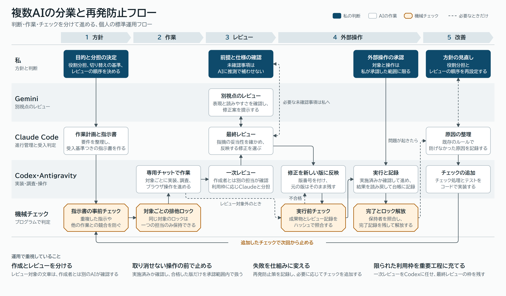

# Multi-AI Division of Labor and Recurrence Prevention

[日本語](README.md)

A personal workflow for delegating work to multiple AI agents by separating decisions, execution, and checks, together with the automated check scripts it uses.



## Overview

I split roles among Claude Code, Codex, Antigravity, and Gemini for personal development (having AI write the code, also known as "vibe coding"), PC troubleshooting, document version control, and similar work. The AI wrote the rule documents, scripts, and diagram; I decided the division of roles, the criteria for switching, and the order of reviews.

| Who | Role |
| --- | --- |
| Me | Set goals and the division of labor. Approve irreversible operations. Revise the policy when a problem occurs. |
| Claude Code | Write work plans and instruction files. In the final review, check whether findings are valid and choose which fixes to apply. |
| Codex / Antigravity | Carry out implementation, investigation, and browser operations in a dedicated chat for each target. Also perform first-pass reviews of work produced by others. |
| Gemini | Check Japanese wording and readability from a separate perspective. |
| Automated checks | Programmatically block duplicate instructions, conflicting work, and changes made after review. |

## Principles

- **Separate writing from review**: Text under review is checked by a different AI from the one that wrote it. Findings are not applied as-is; the final review accepts or rejects each one based on the evidence.
- **Stop before irreversible operations**: Irreversible operations such as publishing or pushing are run only on a version that passed the pre-run check, and only within the targets and operations I approved. Before running, the worker checks whether the same operation has already been done.
- **Turn failures into mechanisms**: When an AI takes a wrong step, I record why the existing rules did not prevent it and, where needed, add an automated check.
- **Allocate limited usage to the key steps**: Assignments switch according to how much usage each service has left. First-pass reviews go to Codex, preserving capacity for the final review.

## Automated checks

A rule that exists only in a document is only effective if someone remembers to enforce it. Starting with the rules that were violated, I have been replacing them with scripts that halt execution.

| Gate in the diagram | Script | What it blocks |
| --- | --- | --- |
| Instruction pre-check | [`tools/dispatch_guard.py`](tools/dispatch_guard.py) | Resending the same instruction, and instructions for a target that another worker is working on or has finished. Also appends a missing ledger-update line, and a missing double-execution prevention line to instructions with irreversible operations. |
| Per-target exclusive lock / Completion and lock release | [`tools/target_lock.py`](tools/target_lock.py) | Concurrent work on the same target, and release by anyone other than the holder. An expired lock can be removed only through takeover, which leaves an audit record. Acquiring the ledger write lock automatically backs up the ledger. |
| Pre-run check | [`tools/release_gate.py`](tools/release_gate.py) | Changes made after review, text files not listed in the manifest, and leftover `{{` or `TODO:`. The manifest (`release_review.json`) specifies the reviewed files using SHA256 hashes. |
| Run and record | [`tools/ledger_cas.py`](tools/ledger_cas.py) | Overwriting rows modified by another worker after the instruction was issued. If even one ledger value differs from the expected value, nothing is written. |

## Handoff rules

- Instructions and deliverables are handed off as files with version numbers.
- An issued version is never rewritten. A fix goes out as a new version that states which version it replaces. Receivers record the hash of each file they receive, so a rewritten version is indistinguishable from a tampered one and stops the work.
- Each target is handled in its own dedicated chat, and work on different targets is not mixed.

## Incidents and the checks they led to

### 1. A worker released another worker's ledger lock

- **What happened**: While several workers were updating the ledger at the same time, a worker that failed to acquire the lock proceeded to write to the ledger, then ran the release command and removed a lock that another worker was holding. An overwrite was prevented only because each worker compared the ledger hash just before writing.
- **Why the rules did not prevent it**: The rule document said "do not touch another worker's lock," but the release command did not check the holder. On the worker side, the exit code of the acquire command was discarded through a pipe.
- **Check added**: The release, beat (liveness record), and completion commands run only when the worker's label and hostname match the holder's. An expired lock can be removed only through takeover, which leaves an audit record (`target_lock.py`).

### 2. A successful operation returned a failure exit code

- **What happened**: After the lock had been acquired and the backup created, printing the completion mark failed in the console's encoding, raised an exception, and returned exit code 1. A worker following the rule "proceed only on exit code 0" would stop while still holding its own lock.
- **Why the rules did not prevent it**: The tests ran only with UTF-8 output, never with the encoding the workers actually used.
- **Check added**: Unprintable characters are now escaped, and the exit code reflects only whether the operation succeeded. A test now runs every command with cp932 output.

### 3. The same work was assigned for a target another worker was handling

- **What happened**: For a target I had assigned directly to another worker, the coordinating AI issued an instruction for the same work. A queued instruction cannot be withdrawn. Because the instruction included a "do not run if already done" line, the work was not executed twice.
- **Why the rules did not prevent it**: "Check locks and completion records before issuing an instruction" was in the rule document, but the check relied on manual enforcement.
- **Check added**: The guard checks locks and completion records for the targets named in an instruction, and blocks the instruction unless the workers on those records are acknowledged with `--seen`. It also blocks resends with the same marker or the same content, and appends a double-execution prevention line to instructions that include an irreversible operation but lack one (`dispatch_guard.py`).

## Usage

Python 3.10 or later, standard library only.

```bash
python -m unittest discover -s tests -v
python tools/target_lock.py status
python tools/target_lock.py claim T001 --by worker-a --note "update README"
python tools/dispatch_guard.py --file examples/dispatch_guard/instruction_pass.txt
python tools/release_gate.py check examples/release_gate
```

State files are stored in `./.workflow/` (change this with `--root` or the `WORKFLOW_ROOT` environment variable). Usage examples for each tool are in `examples/`. Tool messages, code comments, and the examples are in Japanese.

## About this repository

`tools/` contains the general-purpose parts of scripts I actually run, rewritten for general use. The example data is fictional. The diagram is generated by `docs/build_flow.py`.
