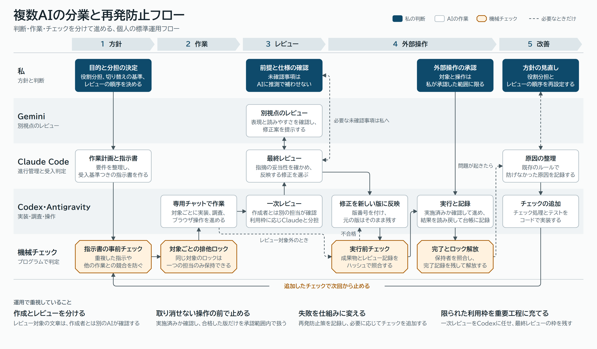

# 複数AIの分業と再発防止フロー

[English](README.en.md)

判断・作業・チェックを分けて、複数のAIエージェントに作業を任せるための個人の運用フローと、その中で使っている機械チェックのスクリプトです。



## 概要

個人開発（AIにコードを書かせる、いわゆる vibe coding）、PCの不具合調査、文書の版管理などで、Claude Code、Codex、Antigravity、Gemini に役割を分けて作業させています。ルール文書・スクリプト・図はAIが作成し、役割分担・切り替えの基準・レビューの順序は私が決めています。

| 担当 | 役割 |
| --- | --- |
| 私 | 目的と分担を決める。取り消せない操作を承認する。問題が起きたら方針を見直す |
| Claude Code | 作業計画と指示書を作る。最終レビューで指摘の妥当性を確かめ、反映する修正を選ぶ |
| Codex・Antigravity | 対象ごとの専用チャットで、実装・調査・ブラウザ操作を進める。他の担当が作成した成果物の一次レビューも行う |
| Gemini | 日本語の表現と読みやすさを、別の視点で確認する |
| 機械チェック | 指示の重複、作業の競合、レビュー後の差し替えをプログラムで止める |

## 運用で重視していること

- **作成とレビューを分ける**：レビュー対象の文章は、作成者とは別のAIが確認します。指摘はそのまま反映せず、最終レビューで根拠に照らして採否を決めます。
- **取り消せない操作の前で止める**：公開や push のように取り消せない操作は、実行前チェックに合格した版だけを、私が承認した対象と操作の範囲で実行します。実行の前に、同じ操作が既に済んでいないかを確かめます。
- **失敗を仕組みに変える**：AIが誤った手順を取ったときは、既存のルールで防げなかった理由を記録し、必要に応じてチェックをコードで追加します。
- **限られた利用枠を重要工程に充てる**：各サービスの利用枠の残りに応じて担当を切り替えます。一次レビューは Codex に任せ、最終レビュー用の枠を残します。

## 機械チェック

ルール文書に書いただけの約束は、守られるかどうかが毎回の確認に左右されます。問題が起きた約束から順に、スクリプトで止める形に置き換えています。

| フロー図の関門 | スクリプト | 止めるもの |
| --- | --- | --- |
| 指示書の事前チェック | [`tools/dispatch_guard.py`](tools/dispatch_guard.py) | 同じ指示の再送と、他の担当が作業中または作業済みの対象への指示。台帳更新の一行や、二重実行を防ぐ一行（取り消せない操作を含む場合）が無い指示には、足りない行を自動で追記します |
| 対象ごとの排他ロック／完了とロック解放 | [`tools/target_lock.py`](tools/target_lock.py) | 同じ対象の同時作業と、保持者以外による解除。期限切れのロックは、監査記録を残す takeover でだけ外せます。台帳の書き込みロックを取ると、台帳を自動でバックアップします |
| 実行前チェック | [`tools/release_gate.py`](tools/release_gate.py) | レビュー後の書き換え、マニフェストに載っていないテキストファイル、`{{` や `TODO:` の消し忘れ。マニフェスト（`release_review.json`）では、レビュー対象のファイルを SHA256 で指定します |
| 実行と記録 | [`tools/ledger_cas.py`](tools/ledger_cas.py) | 指示を書いた後に他の担当が変えた行への上書き。台帳の値が期待値と1か所でも違えば、何も書きません |

## 受け渡しの約束

- 指示書と成果物は、版番号を付けたファイルで受け渡します。
- 発行した版は書き換えません。修正は新しい版で出し、どの版を置き換えるかを書きます。受け手は受け取ったファイルのハッシュを記録しているため、書き換えた版は改ざんと区別できず、作業が止まります。
- 1つの対象は1つの専用チャットで扱い、別の対象の作業を混ぜません。

## 再発防止の事例

### 1. 他の担当の台帳ロックを解除した

- **起きたこと**：複数の担当が同時に台帳を更新したとき、ロックの取得に失敗した担当がそのまま書き込み、続けて解除コマンドを実行して、他の担当が保持していたロックを消しました。上書きを防いだのは、各担当が書き込む直前に台帳のハッシュを照合していたことでした。
- **防げなかった理由**：ルール文書には「他の担当のロックに触れない」とありましたが、解除コマンドは保持者を照合していませんでした。担当の側では、取得コマンドの終了コードをパイプで捨てていました。
- **追加したチェック**：解除・beat（生存の記録）・完了は、担当のラベルとホスト名が保持者と一致するときだけ実行します。期限切れのロックも、監査記録を残す takeover でだけ外せます（`target_lock.py`）。

### 2. 成功した操作が、失敗の終了コードを返した

- **起きたこと**：ロックの取得とバックアップが済んだ後、完了表示の記号をコンソールの文字コードで出力できずに例外となり、終了コード1を返しました。「終了コード0のときだけ次へ進む」約束に従う担当は、自分のロックを持ったまま止まることになります。
- **防げなかった理由**：テストは UTF-8 の出力だけで実行しており、担当が実際に使う文字コードでは試していませんでした。
- **追加したチェック**：出力できない文字はエスケープして表示し、終了コードには操作の成否だけを返します。cp932 の出力で全コマンドを実行するテストを加えました。

### 3. 別の担当が扱っている対象に、同じ作業を指示した

- **起きたこと**：私が別の担当に直接任せていた対象について、統括役のAIが同じ作業の指示を出しました。待ち行列に入った指示は取り消せません。指示に「既に済んでいれば実行しない」という一行があったため、二重の実行は起きませんでした。
- **防げなかった理由**：「指示を出す前にロックと終了記録を確かめる」はルール文書にありましたが、確かめるかどうかは毎回の確認に頼っていました。
- **追加したチェック**：指示に出てくる対象のロックと終了記録を調べ、見つかった記録の担当を `--seen` で名指ししない限り止めます。同じ目印または同じ内容の再送も止め、取り消せない操作を含む指示に二重実行を防ぐ一行が無ければ、その行を自動で追記します（`dispatch_guard.py`）。

## 動かし方

Python 3.10 以上で、標準ライブラリだけを使います。

```bash
python -m unittest discover -s tests -v
python tools/target_lock.py status
python tools/target_lock.py claim T001 --by worker-a --note "README更新"
python tools/dispatch_guard.py --file examples/dispatch_guard/instruction_pass.txt
python tools/release_gate.py check examples/release_gate
```

状態ファイルは `./.workflow/` に置きます（`--root` または環境変数 `WORKFLOW_ROOT` で変更できます）。各ツールの使用例は `examples/` にあります。

## このリポジトリについて

`tools/` は、私が実際に運用しているスクリプトから汎用の部分を取り出し、題材を一般的なものに書き直したものです。例のデータは架空です。フロー図は `docs/build_flow.py` で生成しています。
